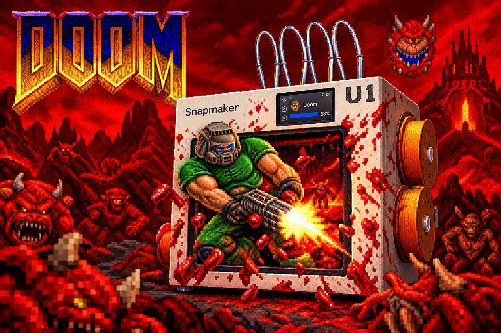

# U1 DOOM

*by Dr. Klipper*



DOOM auf dem Display des Snapmaker U1, mit PS5-Controller und Ton über einen Bluetooth-Lautsprecher.

## Bauen

Unter Linux oder in WSL (Ubuntu):

```sh
sudo apt install make curl bzip2 unzip git libasound2-dev libudev-dev
./build.sh
```

`build.sh` lädt Toolchain, SDL2, SDL2_mixer, doomgeneric und Freedoom (zusammen etwa 190 MB, geprüft mit SHA-256), baut einmal SDL und dann `build/doom`. Ein zweiter Lauf überspringt, was schon da ist.

## Starten

```sh
./start.sh     # Linux, WSL (braucht python3-venv)
start.cmd      # Windows (braucht Python 3 im PATH)
```

Öffnet http://127.0.0.1:8070 (nur von diesem Rechner aus). Die Seite führt in drei Schritten durch Einrichten, Bluetooth und Spielen: Sie verbindet sich per SSH mit dem U1, kopiert alles nach `/userdata/doom`, koppelt Controller und Lautsprecher und startet DOOM.

Unter Windows: das Repository auf einem Windows-Laufwerk auschecken, dort in WSL bauen (`cd /mnt/d/...`) und danach `start.cmd` starten.

## Voraussetzungen am U1

- **Root Access** am Touchscreen an (SSH). Ohne Schlüssel meldet sich die Seite mit dem Standardpasswort an.
- **USB-Bluetooth-Stick:** nötig, siehe nächster Abschnitt.
- **Kein Druck:** Während eines Drucks bleibt DOOM gesperrt.

## Bluetooth-Stick

Ohne USB-Bluetooth-Stick geht es nicht: Das eingebaute Bluetooth des U1 ist in der Firmware abgeschaltet. Der Stick kommt in einen USB-Anschluss des U1.

Entscheidend ist der Chip, nicht die Bluetooth-Version. Viele Sticks brauchen beim Start eine Firmware-Datei vom System, und die bringt der U1 nicht mit.

| Chip im Stick | Läuft? |
|---|---|
| CSR (z. B. CSR8510, USB-ID `0a12:0001`) | ja, getestet mit DualSense und JBL Charge 5 gleichzeitig |
| Broadcom BCM20702 (z. B. ASUS USB-BT400, Plugable USB-BT4LE) | sollte laufen: Treiber im Kernel, startet ohne Firmware-Datei. Nicht getestet |
| Realtek (fast alle Sticks mit „Bluetooth 5.x“, z. B. TP-Link UB500) | nein, die Firmware-Datei fehlt |
| MediaTek | nein, der Treiber fehlt im Kernel |

Am einfachsten im Shop nach „CSR8510“ suchen. Bluetooth 4.0 reicht, Controller und Lautsprecher laufen über klassisches Bluetooth. Ob der U1 den Stick erkennt, zeigt Schritt 2 der Seite: Dort steht der Adapter mit seiner Adresse, sonst „Kein Bluetooth-Adapter am Drucker“.

## Was passiert

| Schritt | Wie |
|---|---|
| Display frei machen | `lmd_cli -K gui`, danach `lmd_cli -S gui` (`printer/run.sh`) |
| Bild | DOOM rendert 320 × 200, skaliert 1,5× auf `/dev/fb0` (480 × 320) |
| Controller | eigenes SDL2 (GameController, DualSense über HIDAPI) |
| Ton | SDL2_mixer → ALSA → `bluealsa` (zuletzt verbundener Lautsprecher), keine Musik |
| Bluetooth | `printer/bt.py` über BlueZ-D-Bus (`dbus_next` auf dem Drucker), startet bei Bedarf `bluealsa` |
| Beenden | Tippen aufs Display, „Beenden“ auf der Seite oder Strg+C |

## Ordner

| Pfad | Inhalt |
|---|---|
| `build.sh` | lädt alles Nötige und baut `build/doom` |
| `src/doomgeneric_u1.c` | Port: Framebuffer, Touch, Tastatur, Controller |
| `printer/` | `run.sh`, `bt.py`: laufen auf dem Drucker |
| `launcher.py`, `launcher/` | die Seite |
| `toolchain/`, `sdl/`, `doomgeneric/`, `wad/`, `download/` | von `build.sh` geladen, nicht im Repository |

## Lizenzen

Dieses Repository steht unter der GPL-2.0 (`LICENSE`), wie doomgeneric, mit dem `build/doom` gebaut wird.

doomgeneric GPL-2.0, Freedoom BSD-artig (`wad/COPYING.txt`), SDL2 und SDL2_mixer zlib, Inter SIL OFL 1.1 (`launcher/inter/LICENSE.txt`). Die Toolchain bringt ihre eigenen Lizenzen mit (`toolchain/`).
